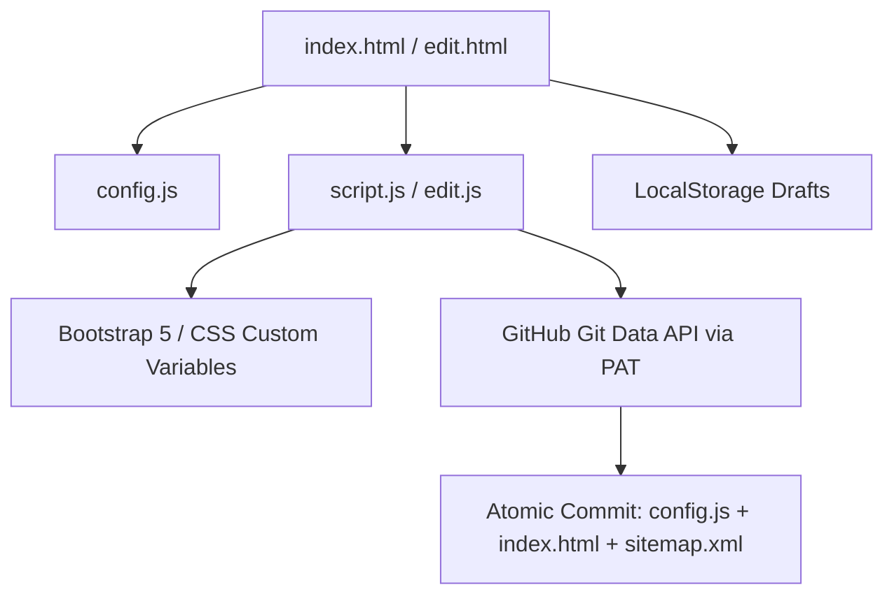

# Beacon Documentation & Configuration Guide

This guide provides a comprehensive overview of the **Beacon** architecture, all supported link types, customization possibilities, configuration details, and export/deployment options.

---

## Table of Contents
1. [Core Architecture](#core-architecture)
2. [Visual Admin Dashboard (edit.html)](#visual-admin-dashboard-edithtml)
3. [Supported Link Types & Component Schemas](#supported-link-types--component-schemas)
4. [Theme & Aesthetic Customization](#theme--aesthetic-customization)
5. [SEO & Metadata Customization](#seo--metadata-customization)
6. [Export & Deployment Options](#export--deployment-options)
7. [Local Development Guide](#local-development-guide)

---

## Core Architecture

Beacon is a **serverless, zero-database personal directory** that runs entirely on the client side.



- **Static Front-end**: Uses HTML5, vanilla JS, and CSS custom variables.
- **Configuration & Pre-rendered SEO**: Data resides in `config.js`, while static SEO tags, JSON-LD schemas, and `<noscript>` fallbacks are pre-rendered into `index.html` alongside `sitemap.xml`.
- **Serverless Editing & Storage**: The Admin Dashboard ([edit.html](edit.html)) writes changes to your browser's `localStorage` as drafts, compiles valid configuration code & HTML, and pushes updates directly back to your GitHub repository using the GitHub Git Data API in a single atomic commit.

---

## Visual Admin Dashboard (`edit.html`)

### Sidebar Navigation Structure
The Admin Dashboard features an organized sidebar workspace ordered as:
1. **Profile**: Edit username, name, title, bio, and avatar.
2. **Skills**: Manage skill badges with Material icons.
3. **Socials**: Manage social links with custom icons.
4. **CTA**: Configure prominent call-to-action buttons.
5. **Featured**: Highlight projects, apps, or case studies.
6. **Links**: Build main vertical link tiles (sublinks, cards, embeds, custom code).
7. **Theme**: Choose presets or build custom HSL/Hex color palettes.
8. **SEO**: Customize canonical URL, Page Title, Meta Description, Language, Theme Color, and Open Graph share tags.
9. **Settings**: Store GitHub PAT credentials securely in local storage.
10. **Save & Deploy**: Atomic GitHub deployment and manual export textareas.

### Features & Capabilities

1. **Split-Screen Simulated Phone Preview**:
   - The editor embeds an iframe of [index.html](index.html) running in a phone simulator.
   - Instantly postMessage-syncs all inputs to the simulator every **300ms** so you can view styling, themes, and layout changes immediately.
2. **Auto-Saving & Draft Recovery**:
   - Compares configurations every **2 seconds**. If changes are detected, a "Saving..." spinner triggers, and the state is persisted to `localStorage` under `bioLinkConfigDraft`.
   - A visible "Discard Changes" button and "Unsaved Local Draft" warning banner appear to prevent loss of work.
3. **Interactive Sortable Lists**:
   - Powered by **SortableJS**, allowing drag-and-drop reordering of skills, links, socials, featured projects, and CTAs.
4. **Atomic GitHub API Integration (Git Trees API)**:
   - Saves your Personal Access Token (PAT) securely inside your browser's local storage.
   - Performs file uploads (e.g., uploading custom PNG or SVG avatars) directly to the repository.
   - Commits `config.js`, `index.html`, and `sitemap.xml` together in a single atomic git commit via GitHub Git Data API.

---

## Supported Link Types & Component Schemas

Beacon supports many different custom link types in the `links` array of `config.js`. Each type is rendered dynamically based on properties defined inside the object:

### 1. Standard Link Tile
A basic link tile containing a title, subtitle, target URL, and an icon.
```javascript
{
  id: "link-portfolio",
  label: "My Developer Portfolio",
  subtitle: "Check out my software projects, tools, and apps",
  url: "https://shazee.dev/",
  icon: {
    type: "material",      // Icon type: 'material', 'svg', or 'image'
    name: "terminal"       // Material symbol name
  }
}
```

### 2. Collapsible Nested Sublinks
Perfect for bundling multiple downloads, resumes, or documents under a single expandable category tile.
```javascript
{
  id: "link-resumes",
  label: "Curriculum Vitae (CV)",
  subtitle: "Access my developer and designer resumes",
  icon: {
    type: "material",
    name: "description"
  },
  sublinks: [
    {
      label: "Fullstack Developer Resume",
      icon: "picture_as_pdf",
      btn1Label: "View Drive",
      btn1Icon: "visibility", // Material symbol
      btn1Url: "https://drive.google.com/your-resume-preview",
      btn2Label: "Direct Download",
      btn2Icon: "download",
      btn2Url: "assets/CV_Developer.pdf" // Local asset path
    }
  ]
}
```

### 3. Expandable Card Grid
Renders an expandable panel that showcases multiple items inside a grid layout complete with images, badges, titles, and descriptions.
```javascript
{
  id: "link-project-breakdown",
  label: "Latest Project Highlights",
  subtitle: "Read about my latest development workflows",
  icon: {
    type: "material",
    name: "article"
  },
  isExpandableCard: true,
  expandedByDefault: false,
  expandableItems: [
    {
      title: "E-Commerce App",
      desc: "Fully responsive checkout interface with payment system.",
      image: "assets/icons/Beacon.png",
      url: "https://github.com/your-username/ecommerce"
    }
  ]
}
```

### 4. Interactive Audio/Video Embed Tile
Creates a collapsable tile that loads audio or video elements directly inside an iframe (supports YouTube, Spotify playlists, SoundCloud, etc.).
```javascript
{
  id: "link-music",
  label: "Coding Playlist",
  subtitle: "Listen to my curated background music on Spotify",
  icon: {
    type: "material",
    name: "play_circle"
  },
  embedUrl: "https://open.spotify.com/embed/playlist/your-playlist-id"
}
```

### 5. Background Image Banner Link
Transforms a link tile into a visual image banner block using a background image.
```javascript
{
  id: "link-banner-promo",
  label: "Special Announcement",
  subtitle: "Read the latest news update here",
  url: "https://example.com/announcement",
  icon: {
    type: "material",
    name: "campaign"
  },
  isBanner: true,
  bannerImage: "assets/icons/Beacon.png" // Image path
}
```

### 6. Custom HTML/CSS/JS Component
Injects custom code fragments directly into the directory flow. Beacon dynamically runs `<script>` segments within this container.
```javascript
{
  id: "link-custom-code",
  isCustomCode: true,
  customCode: `
    <div class="p-3 bg-secondary bg-opacity-10 border rounded-4 text-center">
      <span style="font-weight: bold; color: var(--primary-color);">Dynamic Newsletter</span>
      <p style="margin: 0; font-size: 0.8rem; color: var(--text-muted);">Sign up for monthly design newsletters!</p>
    </div>
  `
}
```

---

## Theme & Aesthetic Customization

Beacon leverages custom themes in the configuration file to instantly change colors and background aesthetics:

### Built-in Presets
Set `preset` in the `theme` configuration property to one of the following strings:
- `"deep-indigo"`
- `"sunset-peach"`
- `"emerald-sage"`
- `"midnight-tech"`
- `"monochrome-ink"`
- `"cyberpunk-neon"`
- `"abyss-slate"`
- `"forest-shadow"`

### Creating a Custom Theme
To build a custom palette, set the preset to `"custom"` and declare your hex colors inside `customColors`:

```javascript
theme: {
  preset: "custom",
  customColors: {
    primary: "#E05A47",      // Action buttons & badge chip borders
    primaryHover: "#C44331", // Interactive hover highlights
    secondary: "#8C6A5C",    // Auxiliary elements
    tertiary: "#E89B7A",     // Mesh background blob colors
    bg: "#FFFDFB",           // Main viewport page background
    cardBg: "#FFFFFF",        // Card containers
    border: "#F7EBE6",        // Dividers
    textMain: "#2E2522",      // Primary font color
    textMuted: "#7A6862"      // Muted titles & bios
  }
}
```

---

## SEO & Metadata Customization

Beacon automatically optimizes your bio link for search engines and AI agents (ChatGPT, Perplexity, Claude, Gemini) by injecting static meta tags, Open Graph data, JSON-LD structured data, and `<noscript>` fallbacks into `index.html`.

### Dynamic Template Parsing (`DOMParser`)
When generating or deploying `index.html`, the editor fetches the latest `index.html` structure (from GitHub API or local origin) and dynamically parses it using `DOMParser`. It updates metadata tags, canonical links, `<noscript>` fallbacks, and JSON-LD schema while preserving all existing HTML layout structure.

### Rich JSON-LD Structured Data
Beacon generates a unified JSON-LD graph:
- **`ProfilePage` & `Person`**: Includes name, job title, bio, canonical URL, avatar image, and `sameAs` array containing all social profile links.
- **`ItemList` & `SiteNavigationElement`**: Iterates over all active links, allowing search engines and AI answer engines to index individual navigation destinations directly.

### Advanced SEO Configuration
You can configure SEO metadata visually in the **SEO Tab** of the Visual Editor (`edit.html`), or manually by defining an `seo` block in `config.js`:

```javascript
seo: {
  siteUrl: "https://yourdomain.com",         // Canonical URL (used in sitemap.xml & og:url)
  pageTitle: "Custom Title | Portfolio",    // Page <title> & og:title override
  metaDescription: "Custom SEO description", // Meta description override
  language: "en",                            // HTML lang attribute
  themeColor: "#222222",                     // Theme color meta tag
  ogImage: "assets/preview.png",             // Open Graph share image
  twitterHandle: "@your_handle",             // Twitter/X handle for cards
  keywords: "bio link, portfolio, developer"  // Meta keywords
}
```

If any of these values are omitted, Beacon intelligently falls back to your profile data and avatar.

### Progressive Web App (PWA) Support
Beacon includes a standard PWA manifest (`manifest.json`) linked inside `<head>` with icon declarations, theme colors, and standalone display mode settings so users can add your bio link directly to their mobile home screen.

### Automated Sitemap Generation
The editor automatically generates a valid `sitemap.xml` file aligned with your `siteUrl` property during export and atomic GitHub deployment.

---

## Export & Deployment Options

Beacon provides three deployment strategies:

### Option 1: Atomic Deploy via Editor (Recommended)
1. Launch [edit.html](edit.html).
2. Click **Settings** and input:
   - **GitHub Username** (e.g. `shazee-04`)
   - **Repository Name** (e.g. `beacon`)
   - **Personal Access Token** (requires `repo` write scope)
3. Navigate to **Save & Deploy** (Export tab) and click **Deploy to GitHub**. This packages `config.js`, `index.html`, and `sitemap.xml` into a single atomic commit via GitHub Git Data API, triggering GitHub Pages deployment.

### Option 2: Manual Export
1. In the Visual Editor, go to the **Save & Deploy** tab.
2. Under **Manual Export**, click **Generate Code**.
3. Use the separate textareas and individual **Copy** / **Download** buttons for:
   - `config.js`
   - `index.html`
   - `sitemap.xml`

### Option 3: Standard GitHub Pages Action
Every push to the default branch triggers the `.github/workflows/static.yml` GitHub Pages deployment workflow. Your site compiles and hosts automatically at `https://<username>.github.io/<repo-name>`.

---

## Local Development Guide

### Prerequisites
- Python 3.x installed, or Node.js runtime if using `serve` utility.

### Running the Project
```bash
# Serve directories using Python
python -m http.server 8000

# Or serve directories using Node
npx serve
```
Navigate to `http://localhost:8000` to view your bio link, and `http://localhost:8000/edit.html` to load the administrator editor.
